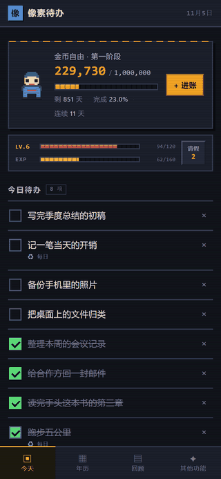
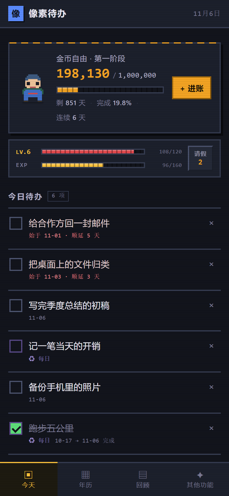
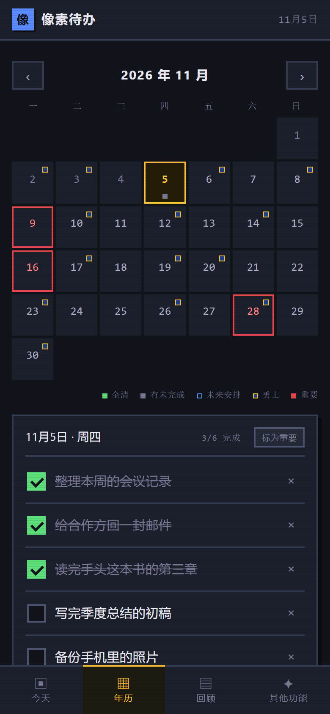
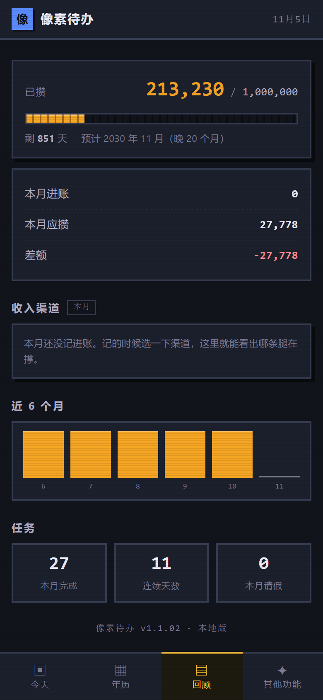
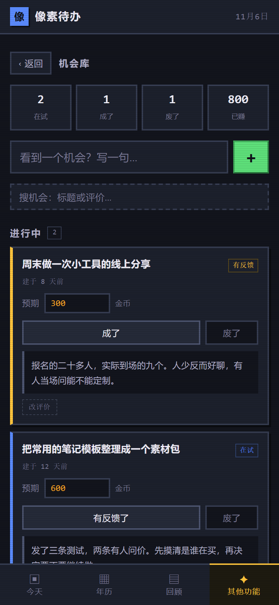
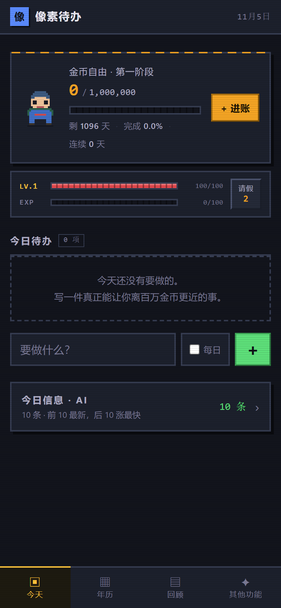

# Pixel Todo

**A pixel-art todo app where saving money is the main quest.**

<p align="center">
  
</p>

No framework. No build step. No backend. No account. One `python -m http.server` and it runs.

## Every screen

<p align="center">
  
  
  
  
  
</p>

---

## Why

Every finance app I tried wanted a bank login, a subscription, or my data on their server. Every todo app I tried was a list — a very polite, very forgettable list.

So the goal lives in the same place as the chores. Saving money isn't a separate dashboard you visit once a month; it's the health bar sitting above today's tasks. Skip your dailies, lose HP. Log income, watch the progress bar move.

The whole thing is one HTML page and three JS files, because I wanted to still understand it in a year.

## What's in it

| | |
|---|---|
| **Today** | Main quest card (saved / target / days left / progress) + RPG status bar (LV / HP / EXP / leave tokens) + today's tasks, **with unfinished ones rolling over day after day** |
| **Calendar** | Month view, schedule tasks ahead, mark important dates, optional external event feed |
| **Review** | Savings progress, projected finish date, this month's income vs. target, **per-channel breakdown**, 6-month bar chart |
| **More** | Opportunity pipeline, **completed task log**, inbox for stray ideas, settings, JSON export/import |
| **News** | Optional: a card that pulls fresh tech news, bilingual, with a "what this could be used for" note |

### Tasks roll over until done

A one-off task dated in the past and still unchecked **shows up again every day** until you tick it or
delete it. No re-creating, no "move to today" button.

- Sorted by how long they've been waiting — the oldest debt sits on top.
- Each row prints its own history: `始于 11-02 · 顺延 4 天` while open, `11-02 → 11-06 完成` once done.
- A task finished today stays in the list, struck through, until the day ends.
- Daily tasks (`♻ 每日`) are exempt — they reset every day instead of accumulating.
- The old "昨天还剩 N 件 · 去看" banner is gone; those tasks are simply in the list now.

### The RPG layer

| Action | Effect |
|---|---|
| Finish a task | +12 EXP, +4 HP |
| Finish a daily task | +8 EXP, +4 HP |
| Miss a daily task | −15 HP each |
| HP hits zero | Drop a level, revive at half HP, **no data lost** |
| EXP full | Level up, +10 max HP, full heal |
| Take a leave day | 2 tokens/month, stacks up to 999, no HP loss, streak preserved |

Leave tokens only block the daily-task penalty. An unfinished one-off task just turns red and waits.

### The money side

Your target isn't one big number, it's the sum of a few legs.

| | |
|---|---|
| Default channels | Salary / Side gig / Investment — rename, delete, add up to 6 |
| Logging income | Pick a channel, the amount is stored with it |
| Review page | This month per channel + a share bar; if you set a monthly target it shows the gap |
| Old data | Income logged before channels existed lands in "Uncategorized". Nothing is dropped |
| Ledger | `查看全部记录` inside the income panel opens a full list: amount, channel tag, date, note. Top shows count / total / this month |
| Deleting | Each row has `删`, which expands an inline confirm (`删掉这笔 3,000？` + delete / cancel) — no system dialog. Confirming removes the row **and subtracts the same amount from the main quest balance**, so the number on the home card drops in the same frame. If the entry came from an opportunity, that opportunity flips back to `settled: false` and returns to the "wait to record" state |

### Opportunity pipeline

One card = one way to make money. Five states, forward only:

```
idea → trying → feedback → landed / dead
```

Dead ones are kept, not deleted. After a year that column tells you how many things you actually tried, and how many worked.

Each card also takes a **review** (`＋ 写评价` / `改评价`, up to 300 chars). It is shown as a quoted block
on the card, saved with the opportunity, and searchable. Clearing the text removes it.

The page header counts four things: `在试 / 成了 / 废了 / 已赚`. Those numbers are global — they do not
change when you search.

A search box under the capture field filters the list as you type, matching **title or review**.
Sections with no hits collapse; if nothing matches at all you get `没有匹配「关键词」的机会，换个词试试。`
with an `×` to clear.

### Completed task log

Every time you tick a task, one record is appended: text, finish time, and what it actually paid out
(EXP, HP recovered, or a level-up). Unticking removes the record **and takes the payout back**:
EXP and HP return to what they were, and if that EXP was what pushed you over the line, the level drops too.

- Entry lives in **More → 已完成任务**, with a running total on the card itself.
- Search filters by task text as you type.
- **Manual payout**: each row has a `＋ 收益` button. Tap it, type an amount, Enter — it becomes `¥8,000`.
  Nothing entered means no payout. Clearing it (0 or empty) puts the button back.
  The amount is a record only: it does **not** touch the main quest balance or the income log.
- Four sort modes: newest, oldest, highest payout, lowest payout. "Payout" compares the manual amount
  first, then EXP, then time.
- **Seed an opportunity**: each row has `＋ 放入机会库`. It adds one card to the opportunity pipeline
  using the task text, then flips to `✓ 已在机会库` and greys out. The completion record itself is
  **never removed or reordered** — it stays exactly where it was, with its time and payout intact.
- Tasks finished before this feature existed are back-filled once on load. If the old record had no
  finish time, it falls back to the task's creation time and is shown slightly dimmed.
- **The log is append-only with respect to existing data**: loading an older save adds the `doneLog`
  field and nothing else. Verified by hashing all ten pre-existing fields before and after the upgrade —
  zero changes.

## Run it

```bash
git clone https://github.com/<you>/pixel-todo.git
cd pixel-todo
python -m http.server 8765 --bind 127.0.0.1
# open http://127.0.0.1:8765
```

> On Windows, Python's `http.server` sometimes reports `.js` as `text/plain`, which blocks Service Worker registration. That's a local-dev quirk — it works fine on any static host.

To use it on a phone: open the page, then "Add to Home Screen". It runs fullscreen with no address bar.

## Data

Everything lives in `localStorage` under `pixel-todo-v2`. No sync, no cloud, no telemetry.

A fresh install starts from an empty sheet — no sample data, no demo account, no seed file:

<p align="center"></p>

That means **clearing your browser data deletes your data**. Settings has JSON export — use it. The loader is defensive: if it can't parse what's stored, it copies the raw string to a rescue key before falling back to a blank state, so a corrupt read never silently overwrites good data.

## How it's built

- Pure static PWA. Native JS, no dependencies, no bundler.
- Service Worker for offline caching.
- Design system in `styles.css`: zero border-radius, hard borders, segmented bars. Every pixel is on purpose.
- The character in `hero.js` is drawn on a 20×20 canvas grid — no sprite sheet, no image files.

## Files

| File | What it does |
|---|---|
| `index.html` | Skeleton for all six views |
| `styles.css` | Pixel design system |
| `hero.js` | Draws the pixel character on canvas |
| `app.js` | State, day rollover, quest progress, income, news fetching, heatmap |
| `sw.js` | Offline cache |
| `manifest.webmanifest` | PWA manifest |
| `tools/shot.js` | Screenshot and run JS in a page via the DevTools protocol — used for self-checks |
| `tools/record.js` | Records a scripted sequence of frames from a running page |
| `tools/make-gif.py` | Assembles those frames into the demo GIF with one shared palette |
| `tools/version.py` | Snapshot / restore: `list` · `snap <ver>` · `restore <ver>` |
| `tools/gen_icon.py` | Generates PNG icons with the standard library only, no PIL |
| `tools/fetch_gsw.py` | Pulls an NBA schedule + injury list into `assets/` |

## Design decisions

- **The character got smaller.** A full-body hero ate the first screen. The savings target is the protagonist.
- **One task list.** The old "must-do dailies" and "today's tasks" split was merged — a `daily` toggle covers it.
- **The health bar survived a quest change.** The main quest moved from leveling up to saving money; the HP bar stayed on as a daily rhythm keeper. Missing a daily costs HP, which doesn't conflict with the money goal.
- **Finished tasks sink.** Once a list gets long, completed items at the top are just obstacles.

## License

MIT
