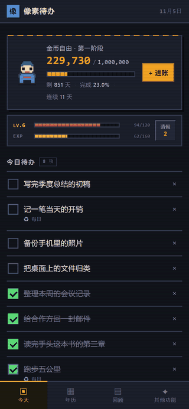
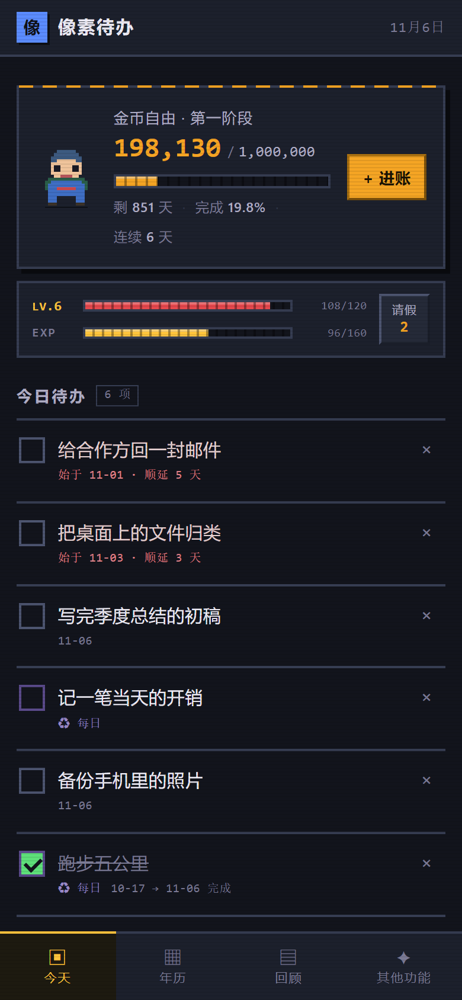
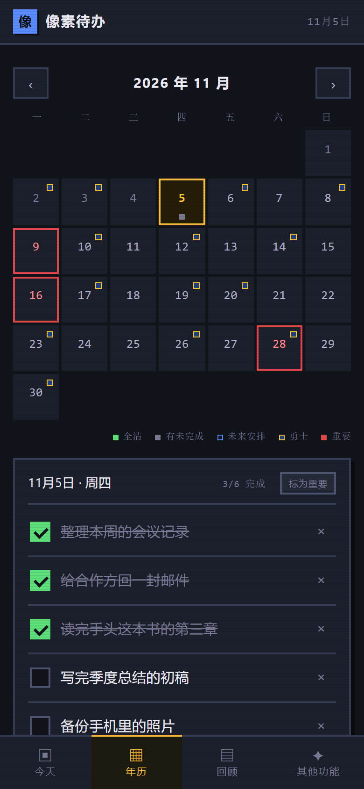
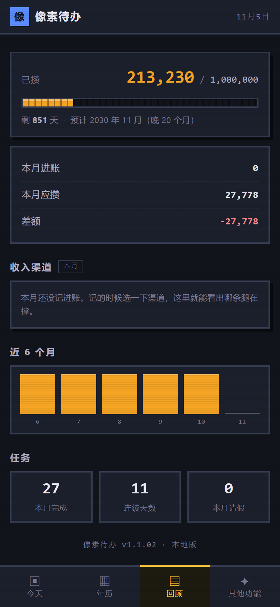
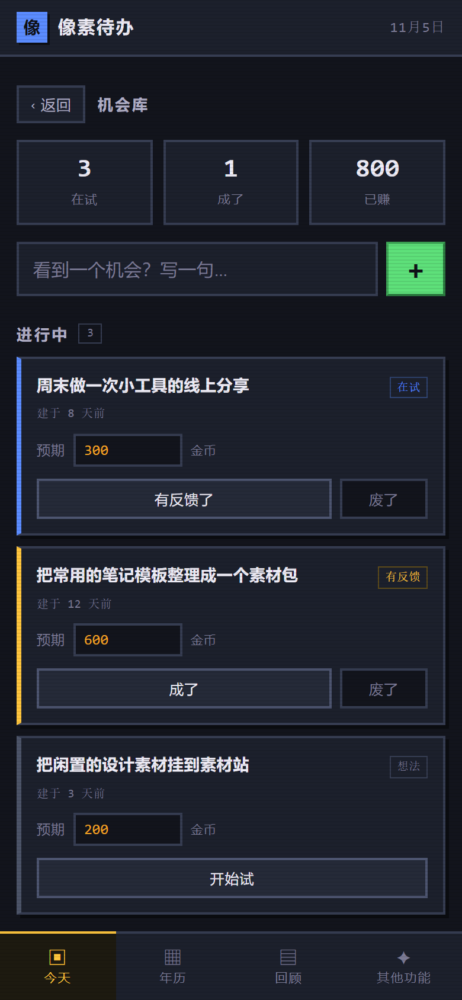
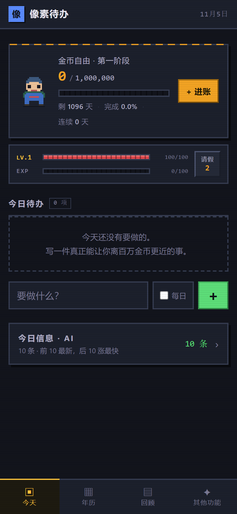

# 像素待办

**一个把攒钱当主线任务的像素风待办 App。**

<p align="center">
  
</p>

无框架、无构建、无后端、无账号。一句 `python -m http.server` 就能跑。

**[English](README.md) | 简体中文**

## 各个页面

<p align="center">
  
  
  
  
  
</p>

---

## 为什么做这个

市面上的记账 App 要你连银行、要订阅、要把数据放它服务器上；待办 App 就是一个列表——很客气，也很容易被忘掉。

所以我把攒钱和待办放进了同一个地方。攒钱不是每月打开一次的报表，是压在今日待办上面的那条血条：漏做日常，掉血；记一笔进账，进度条往前走。

整个东西是一个 HTML 加三个 JS 文件，因为我希望一年之后自己还能看懂它。

## 有什么

| 标签页 | 内容 |
|---|---|
| **今天** | 主线卡（已攒 / 目标 / 倒计时 / 进度）+ 血条（LV / HP / EXP / 请假条）+ 今日待办 |
| **年历** | 月视图，可提前排期，可标红重要日期，可接外部赛事数据 |
| **回顾** | 已攒与进度、按当前速度的预计达成日、本月进账 vs 应攒、**收入渠道分布**、近 6 个月柱状图 |
| **其他功能** | 机会库、灵感收件箱、设置、JSON 导出导入 |
| **今日信息** | 可选模块：抓最新科技资讯，中英对照，带「能怎么用」的解读 |

### 血条与请假条

| 行为 | 效果 |
|---|---|
| 完成普通待办 | +12 EXP · 回 4 血 |
| 完成每日待办 | +8 EXP · 回 4 血 |
| 漏做每日待办 | −15 HP / 件（普通待办不扣） |
| 血量归零 | 掉一级，半血复活，**数据不删** |
| EXP 满 | 升级，血量上限 +10，回满血 |
| 请假 | 每月发 2 张，可叠加到 999 张，当天不扣血，连续天数不中断 |

请假条只挡「漏做每日任务」这一刀。普通待办没做完不扣血，只会挂着变红。

### 攒钱

主线的一百万不是一个大数，是几条腿的加总。

| 项 | 说明 |
|---|---|
| 默认渠道 | 工资 / 副业 / 投资，可改名、可删、可加，上限 6 条 |
| 记进账 | 面板上选一条渠道，跟着那笔钱一起存 |
| 回顾页 | 本月每条渠道的金额 + 占比条；设了月目标的显示「差多少 / 已达成」 |
| 老数据 | 没有渠道的历史进账归到「未分类」，不丢 |

### 机会库

一张卡就是一条赚钱路子，五个状态按顺序推进：

```
想法 → 在试 → 有反馈 → 成了 / 废了
```

废了的不删，留着——一年后这列能看出你真正试过多少件事，成了几个。

## 本地跑

```bash
git clone https://github.com/<you>/pixel-todo.git
cd pixel-todo
python -m http.server 8765 --bind 127.0.0.1
# 打开 http://127.0.0.1:8765
```

> Windows 上 Python 自带的 `http.server` 可能把 `.js` 的 MIME 报成 `text/plain`，导致 Service Worker 注册失败。这是本地测试环境的问题，任何静态托管都正常。

手机上用：浏览器打开 → 菜单「添加到主屏幕」→ 全屏运行，无地址栏。

## 数据

全部存在浏览器 `localStorage`（键 `pixel-todo-v2`）。没有同步、没有云端、没有埋点。

全新安装是一张空表——没有示例数据，没有演示账号，没有任何预置文件：

<p align="center"></p>

也就是说：**清浏览器缓存 = 数据没了**。设置页有 JSON 导出，用它兜底。

读取逻辑是防御性的：解析失败时先把原始字符串存进救援槽，再回退到空白状态——一次读坏不会静默覆盖掉好的数据。

## 技术形态

- 纯静态 PWA，原生 JS，零依赖，零构建
- Service Worker 离线缓存
- `styles.css` 是完整的像素设计系统：零圆角、硬边框、分段条，每个像素都是有意的
- `hero.js` 里的小人在 20×20 的画布网格上现画，没有雪碧图，没有图片文件

## 文件

| 文件 | 作用 |
|---|---|
| `index.html` | 六个视图的骨架 |
| `styles.css` | 像素风设计系统 |
| `hero.js` | 在 canvas 上画像素小人 |
| `app.js` | 状态、跨天结算、主线进度、进账、资讯拉取、热力图 |
| `sw.js` | 离线缓存 |
| `manifest.webmanifest` | PWA 清单 |
| `tools/version.py` | 版本快照与回退：`list` / `snap <ver>` / `restore <ver>` |
| `tools/gen_icon.py` | 用标准库生成 PNG 图标，不依赖 PIL |
| `tools/shot.js` | 通过 DevTools 协议截图 / 执行脚本，用于自检 |
| `tools/record.js` | 按脚本连续抓帧，用来录演示动图 |
| `tools/make-gif.py` | 把帧合成 GIF，共用一份调色板避免闪烁 |
| `tools/fetch_gsw.py` | 抓 NBA 赛程与伤病名单到 `assets/` |

## 设计取舍

- **人物缩成小头像**：大图舞台浪费首屏空间，攒钱目标才是主角
- **合并待办**：不再分「每日必做」和「今日任务」两个区，用 `每日` 开关区分
- **主线换了但血条留着**：主线从练级换成攒钱，血条退居次要位置当每日节奏器——漏做每日掉血，跟主线不冲突
- **完成的沉底**：列表变长后，做完的堆在上面会挡路

## 版本纪律

见 `VERSION.md`。改完先 `snap` 再交付，回退一句话搞定：

```bash
python tools/version.py restore 1.0.01
```

## License

MIT
